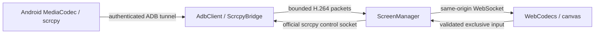

# M5 live screen architecture

The selected pipeline is the official **scrcpy 3.3.4 Android server**, authenticated ADB forwarding, a FastAPI WebSocket packet bridge, and browser WebCodecs H.264 decoding into a canvas. There is no backend decoding or transcoding, desktop scrcpy window, additional service, public streaming port, permanent Android installation, or root requirement. The temporary dex/JAR is executed with Android's existing ADB shell privileges and removed during cleanup.

## Versioned upstream protocol and playback

The bridge implements the documented protocol for the pinned server version, including startup metadata, packet sizes, codec configuration, keyframe flags and microsecond presentation timestamps. It preserves scrcpy's 12-byte packet header: big-endian 64-bit timestamp/flags followed by a 32-bit payload length. Bit 63 marks configuration, bit 62 marks a keyframe, and the lower 62 bits hold presentation time. Payloads are H.264 Annex B access units. Configuration contains SPS/PPS; the browser derives the AVC codec identifier from SPS, checks `VideoDecoder.isConfigSupported`, and prepends configuration to keyframes. No raw stream is assigned to an HTML video element. This follows the [pinned scrcpy developer protocol](https://github.com/Genymobile/scrcpy/blob/v3.3.4/doc/develop.md) and [WebCodecs AVC registration](https://w3c.github.io/webcodecs/avc_codec_registration.html).

Canvas dimensions follow decoded frame dimensions. Pointer mapping uses the rendered content rectangle and actual encoded dimensions, accounting for fit scaling and letterboxing. Rotation changes the encoded display geometry; stale input dimensions are rejected by the backend. Android restrictions, protected content and manufacturer encoder behavior can still prevent capture or input.

## Alternatives evaluated

| Architecture | Assessment |
| --- | --- |
| WebCodecs + WebSocket | Selected: direct access-unit decoding, no transcoding, existing same-origin proxy and local security boundary. TCP head-of-line blocking remains possible. |
| WebRTC bridge | Suitable for remote networks and adaptive transport, but needs RTP packetization, signaling and ICE infrastructure. Not needed for this local deployment; no WebRTC dependency or extra ports added. |
| MSE / HTML video | Requires container muxing and segment management; raw scrcpy H.264 is not a playable media source. Segment buffering complicates low-latency interactive playback. |
| Mature browser scrcpy libraries | [Tango's maintained scrcpy integration](https://tangoadb.dev/scrcpy/) validates the approach and supports WebCodecs, but adopting its browser ADB transport would duplicate the backend-owned authenticated ADB boundary. M5 retains a small version-pinned bridge. |
| Screenshot polling | Does not satisfy live encoded video and is not a fallback. |

The [WebCodecs specification](https://www.w3.org/TR/webcodecs/) requires a secure context and runtime codec support checks. Current Chromium on trustworthy localhost or HTTPS is the primary browser target. Firefox and Safari are feature-dependent: M5 does not claim blanket compatibility. Missing `VideoDecoder`, an insecure context or unsupported H.264 profile produces an explicit error. There is no silent nonfunctional player fallback. Actual tested browser versions and results belong in [M5 validation](M5_VALIDATION.md).

## Ownership, resources and recovery

One application process owns sessions, bridges and cleanup. Defaults allow four active sessions globally, two per device and two per identity, with one controller per device. Multiple viewers use separate device-side encoders and tunnels; M5 does not multiplex a shared encoder. This bounds concurrency but increases device CPU and bandwidth per viewer. Defaults are H.264, maximum dimension 1280, 30 FPS ceiling and 4 Mbit/s target; actual FPS depends on screen changes and encoder behavior. No guarantee is made that a static screen reaches the FPS ceiling.

Server queues default to eight packets. Overflow drops buffered video and waits for a keyframe, preserving codec configuration. Browser decoding also bounds queued work and terminates an excessively slow client with a lower-quality restart message. WebSocket sends have a five-second deadline. Memory is bounded by queue and packet limits; device encoding and browser decoding carry most compute cost. Backend CPU, memory and bandwidth still scale with packet forwarding and viewer count. Measurements, rather than inferred zero-transcoding savings, are recorded in validation.

Transport failures release control, clean the previous stream and permit two bounded retries. Browser disconnect stops its session. Idle sessions expire after 30 seconds without activity; the browser sends ten-second heartbeats. Backend shutdown stops sessions; restart uses a private transport manifest to clean only recorded tunnels/processes. Sessions and control ownership are not restored. No screen contents are persisted. Cleanup failures are observable and cannot guarantee deletion while a device remains unreachable.

## Distribution and security boundary

Docker downloads the official [3.3.4 release server](https://github.com/Genymobile/scrcpy/releases/tag/v3.3.4), verifies SHA-256 `8588238c9a5a00aa542906b6ec7e6d5541d9ffb9b5d0f6e1bc0e365e2303079e`, and includes its Apache-2.0 license at `/opt/scrcpy/LICENSE` from `docker/licenses/scrcpy-LICENSE`. Server/client protocol versions must match; upgrading requires protocol fixtures and real-device acceptance. The WebSocket runtime dependency is pinned to `websockets==15.0.1`. This does not make all pre-existing Python, Debian or base-image dependencies digest locked.

All ADB work stays behind `AdbClient`; REST handlers never spawn commands. Container-local forwarding is private and ADB server port 5037 remains unpublished. The existing frontend/backend loopback ports, named volumes, RSA pairing credentials and Colima networking remain unchanged. Session-bound, single-use, 30-second tickets travel in the first WebSocket message rather than URLs. REST uses the existing bearer/RBAC system. Origin checks, ownership, device scope, input schemas and rate limits remain backend-enforced. See [API](API.md), [authorization](AUTHORIZATION.md) and [security](SECURITY.md).

## Deliberate limits

No audio, clipboard synchronization, recording, unrestricted shell, multi-touch gestures, browser software decoder, automatic control reacquisition or durable live sessions. Text injection uses scrcpy's Android text mechanism; complex Unicode/IME behavior is device-dependent. Local decode delay is not network or end-to-end latency. Long-duration load, real hardware input, rotation and unsupported-browser acceptance must be reported independently; implemented support is not acceptance evidence. M6 should prioritize shared-encoder fan-out, remote authenticated TLS/identity lifecycle, broader browser decoding, measured latency and longer fleet soak tests.

## M6 stability update

M6 parses bounded H.264 SPS configuration to update server geometry after rotation or
resize; malformed geometry fails pointer input closed. Pointer coordinates must match
the current encoded geometry exactly. Rotation cancels held gestures. Decoder
configuration and cleanup have generation guards, bounded keyframe recovery and
resource release on tab suspension. Quick restart waits for old transport cleanup.
Control remains explicit after every reconnect.

Separate capture per viewer remains the measured, bounded implementation; sharing
requires a distinct quality/control ownership design and was not folded into stability
work. See [M6 validation](M6_VALIDATION.md), [performance](M6_PERFORMANCE.md),
[browser acceptance](M6_BROWSER_COMPATIBILITY.md) and [operations](M6_OPERATIONS.md).
