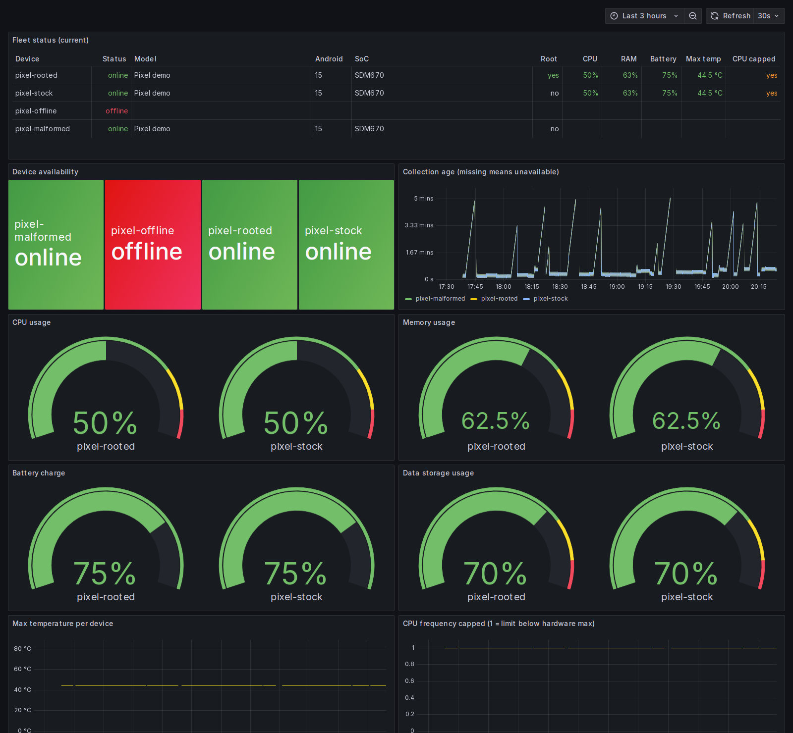
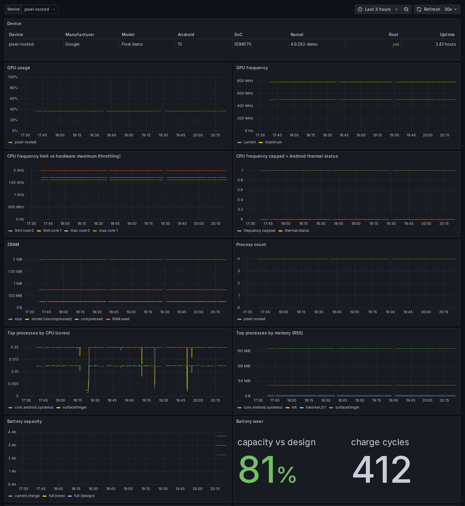
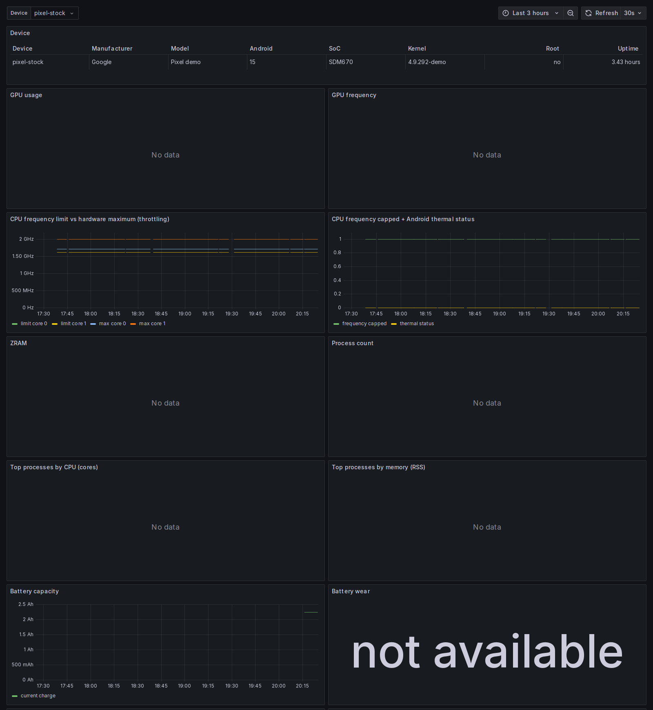

# Školní zadání: monitoring rootnutých Android zařízení

Tento dokument popisuje, co bylo doplněno do Android Fleet Dashboardu kvůli školnímu
zadání, jak je každý bod zadání splněný, jak to bylo ověřené a co ještě zbývá.
Spuštění, testování a nasazení krok za krokem je v [NAVOD.md](../NAVOD.md).

## Cíl

Centrální monitoring více rootnutých Android telefonů **bez aplikace, SSH serveru nebo
agenta na telefonu**. Telefony jsou dostupné přes ADB over TCP/IP s RSA klíči. Root
(`su`) zpřístupňuje detailní údaje z `/proc`, `/sys` a `dumpsys`.

```text
Android zařízení (pevná IP, ADB TCP :5555, Magisk root)
  → ADB over TCP/IP (RSA klíče)
  → centrální collector (Python, FastAPI, /metrics)
  → Prometheus (časové řady, historie 30 dní)
  → Grafana (přehled flotily + detail zařízení)
```

Vedle Grafany běží React dashboard (`:8088`). Grafana slouží k monitoringu a historii,
React ke správě: registrace telefonů, stav spojení, alerty, obrazovka, terminál.

## Zadání bod po bodu

Legenda: ✅ hotovo a ověřeno, 🟡 hotovo v kódu a otestováno na simulovaných
zařízeních, na skutečném telefonu ještě ne, ⬜ nehotovo.

| Požadavek | Stav | Jak |
|---|---|---|
| Bez aplikace/agenta na telefonu | ✅ | Vše jde přes ADB shell příkazy (`cat`, `dumpsys`, krátké `sh` skripty). |
| ADB over TCP, pevný port, RSA klíče | 🟡 | `device-setup/`: Magisk skript zapne port 5555, klíč serveru se přidá do `adb_keys`, `ro.adb.secure` zůstává zapnuté. |
| Využití `su` pro detailní údaje | ✅ | Collectory ZRAM, GPU, procesy, teploty a strop frekvence běží přes `su -c`, pokud detekce root zjistila. Když `su` selže, zkusí se to bez rootu. |
| Seznam zařízení, automatické připojení, pravidelný sběr | 🟡 | Registr zařízení (SQLite), sběr každých 30 s nezávisle na kontrole spojení. |
| Dostupnost a stav ADB spojení | ✅ | `android_device_up`, `android_device_last_seen_timestamp_seconds`, stáří posledního sběru. |
| CPU celkem, po jádrech, frekvence | ✅ | `/proc/stat` (rozdíly mezi vzorky), `scaling_cur_freq`. |
| RAM, swap, ZRAM | ✅ | `/proc/meminfo`, `/sys/block/zram*/mm_stat`. |
| Úložiště | ✅ | `df -k /data`. |
| Síťový provoz | ✅ | Čítače z `/proc/net/dev`, v Grafaně `rate()`. |
| GPU (vytížení, frekvence) | ✅ / 🟡 | Qualcomm Adreno (`kgsl`) ověřeno na Pixelu 3a. Arm Mali (Tensor, Exynos, MediaTek) podle dokumentace, neověřeno. |
| Teploty CPU, GPU, baterie a dalších zón | ✅ | `dumpsys thermalservice`, záložně `/sys/class/thermal` přes `su`. |
| Baterie: kapacita, napětí, proud, teplota, nabíjení | ✅ / 🟡 | `dumpsys battery` + `current_now`. Kapacita: zbývající náboj (ověřeno), plná a původní kapacita a počet cyklů ze sysfs (neověřeno). |
| Uptime | ✅ | `/proc/uptime`. |
| Info o zařízení, Androidu, kernelu, SoC | ✅ | `android_device_info{manufacturer,model,android_version,soc,kernel}`. |
| Procesy | ✅ | Počet procesů, top 5 podle CPU a top 5 podle paměti (RSS). |
| Specifické collectory pro platformy (NPU/DSP) | 🟡 | Architektura to umožňuje: GPU má oddělené backendy vybírané podle souborů v `/sys`, ne podle názvu čipu. NPU/DSP metriky zatím nejsou (zadání je řadí do dalších fází). |
| Formát pro Prometheus, ukládání časových řad | ✅ | `/metrics`, Prometheus s retencí 30 dní / 400 MB. |
| Grafana: přehled všech zařízení + detail | ✅ | Viz snímky níže. |
| Historická data, thermal throttling | ✅ | Grafy v čase; strop frekvence CPU vs. hardwarové maximum vedle teplot a Android thermal status. |
| Automatické obnovení spojení (restart, Wi-Fi) | 🟡 | Je v původním kódu a byl ověřen na jiném telefonu; na telefonech v laboratoři zatím ne. |
| Dostupnost jako metrika v Grafaně | ✅ | Panel „Device availability“ a sloupec Status. |
| ADB TCP po restartu telefonu (Magisk `service.d`) | 🟡 | `device-setup/magisk/adb_tcp.sh`. |
| Port 5555 jen pro centrální server | 🟡 | Tentýž skript: iptables řetězec `adb_guard` (povoleno jen `lo` a IP serveru), IPv6 na 5555 zakázáno. |
| Upozornění na problémy | ✅ | Alerty v React dashboardu (backend). V Grafaně nejsou. |

## Co bylo doplněno

### Collectory (backend)

Nové soubory v `backend/src/android_fleet/collectors/`:

- `zram.py`: velikost ZRAM, uložená data, komprimovaná velikost a skutečně použitá RAM.
  Sčítá všechna zram zařízení, přeskakuje nenakonfigurovaná a umí i starší kernely bez
  `mm_stat`.
- `cpu_limits.py`: hardwarové maximum (`cpuinfo_max_freq`) a aktuální strop
  (`scaling_max_freq`) každého jádra. `android_cpu_frequency_capped = 1`, když je strop
  pod maximem, což je typický projev thermal throttlingu.
- `gpu.py`: vytížení a frekvence GPU. Backendy Adreno a Mali; backend se vybírá podle
  toho, které soubory v `/sys` existují. Další platformy (i NPU/DSP) se přidají stejně.
- `processes.py`: čte `/proc/*/stat` a `cmdline`. CPU procesu je rozdíl tiků mezi
  dvěma sběry děleno uplynulým časem (1 = jedno plně vytížené jádro). Při restartu nebo
  znovupřipojení se nejdřív jen ukládá výchozí vzorek; recyklovaná PID se poznají podle
  času startu procesu. Do labelů jde jen top 5, aby se nezahltil Prometheus.

Úpravy existujícího kódu:

- `collectors/common.py`: `read_script()` spustí skript přes `su -c`, pokud zařízení
  má root, jinak (nebo při selhání `su`) přes `sh -c`.
- `collectors/battery.py`: náboj baterie (`Charge counter`), plná a původní kapacita
  a počet cyklů.
- `collectors/cpu.py`, `collectors/thermal.py`: záložní čtení přes `su`, když shell
  uživatel nemá práva.
- `collectors/storage.py`: přijímá i `/data_mirror/...` (viz test na telefonu).
- `devices/probe.py`: zjišťuje SoC (`ro.soc.model`, záložně `ro.board.platform`) a
  verzi kernelu (`uname -r`).
- `metrics/catalog.py`, `metrics/exporter.py`: nové metriky a jejich názvy pro
  Prometheus, metrika `android_device_info`, omezení počtu hodnot labelů.

Kompletní seznam metrik je v [METRICS.md](METRICS.md).

Zásada projektu zůstala zachovaná: **chybějící hodnota se nikdy nenahrazuje nulou.**
Když telefon údaj neposkytne (nerootnutý telefon, jiný výrobce GPU), metrika chybí a
Grafana ukáže „No data“.

### Grafana

- **Přehled flotily:** nová tabulka „Fleet status“, jeden řádek na telefon: stav, model,
  Android, SoC, root, CPU, RAM, baterie, max. teplota, omezení frekvence. Dále panel
  dostupnosti (online/offline), graf maximální teploty a omezení frekvence v čase.
- **Detail zařízení:** nahoře tabulka s identitou zařízení, pod ní nové panely GPU,
  strop frekvence CPU, omezení + thermal status, ZRAM, počet procesů, top procesy podle
  CPU a paměti, kapacita a opotřebení baterie. Původní grafy (CPU, RAM, baterie, síť,
  teploty…) následují pod nimi.

Přehled flotily (simulovaná zařízení):



Detail rootnutého zařízení: GPU, ZRAM, procesy a baterie mají data:



Detail nerootnutého zařízení: údaje vyžadující root chybí, místo vymyšlených nul je
„No data“:



### Příprava telefonů (`device-setup/`)

- `magisk/adb_tcp.sh`: Magisk `service.d` skript. Po startu telefonu počká na dokončení
  bootu, nastaví firewall (port 5555 jen ze serveru) a zapne ADB na TCP 5555.
- `setup_device.sh`: jednorázová příprava telefonu přes ADB nebo Termux SSH. Nainstaluje
  boot skript, přidá ADB klíč serveru, nastaví v Magisku `su` pro ADB shell bez
  upozornění a hned zapne ADB TCP.
- `README.md`: postup a vrácení všech změn.

### Nasazení na malou VM

Školní VM má 2 vCPU, 1,4 GB RAM a jen ~2,9 GB volného disku.

- `docker-compose.school.yml`: hotové image bez buildu, paměťové limity kontejnerů,
  Prometheus omezený na 30 dní / 400 MB, vypnutá telemetrie Grafany.
- `deploy/school/ship_images.sh`: pošle hotové image přes SSH (`docker save | gzip |
  ssh docker load`), takže se na VM nic nebuilduje.

Naměřeno: celý stack zabírá ~160 MB RAM. Omezením je disk, image mají ~1,6 GB.

## Ověření

### Automatické testy

Backend na Linuxu (Python 3.13): **554 testů prošlo**, ruff a mypy bez chyb. Nové testy
(`backend/tests/test_root_collectors.py` a doplnění ostatních) pokrývají:

- parsery na správných, poškozených a nepodporovaných výstupech,
- rootnuté a nerootnuté zařízení, selhání `su` a záložní cestu bez rootu,
- výchozí vzorek procesů, recyklovaná PID, reset po odpojení,
- celou cestu detekce zařízení → collectory → export do Prometheu,
- výstupy zachycené na skutečném Pixelu 3a XL.

Tři starší testy streamování obrazovky a terminálu jsou citlivé na časování a občas
selžou i na původním kódu. S monitoringem nesouvisí.

### Test se skutečným telefonem

Pixel 3a XL v laboratoři (SDM670, Android 12, kernel 4.9, Magisk):

1. Přes Termux SSH se na telefonu jen pro čtení spustily **přesně tytéž příkazy, které
   používá collector**, jednou bez rootu a dvakrát přes `su` (54 s od sebe).
2. Výstupy se přehrály přes skutečný kód detekce zařízení, collectorů a exportéru.

Výsledek: všechny rodiny metrik dostaly hodnoty, mimo jiné:

- 8 jader CPU,
- strop 1,71 / 2,0 GHz,
- ZRAM 2 GB (825 MB dat zkomprimováno na 122 MB),
- Adreno GPU 180 / 430 MHz,
- 13 teplotních senzorů,
- 881 procesů,
- baterie včetně náboje.

Bez rootu Termux uživatel nepřečte ani `/proc/stat` a teploty, takže root je opravdu
potřeba.

Test odhalil dvě chyby, které simulovaná data nezachytila. Obě jsou opravené a pokryté
testem:

1. Na Androidu 11+ hlásí `df -k /data` přípojný bod `/data_mirror/...` (bind mount
   stejného oddílu) a úložiště se zahazovalo.
2. Zygote a z něj spuštěné procesy mají v jádře obecné jméno `main`; teď se bere
   skutečné jméno z `cmdline` (např. `zygote64`).

Zajímavost: telefon trvale na nabíječce hlásí stav baterie „overheat“ (health 3) při
31 °C. Collector hodnotu čte správně, je to údaj telefonu.

Nebylo ověřeno: skutečné spojení přes ADB TCP a pravidelný sběr, obnova spojení po
restartu telefonu, Magisk skript a firewall, Mali GPU (Pixel 9 Pro), Nexus 5X
(Android 8) a sysfs soubory kapacity baterie.

## Co zbývá

1. **Plný test přes ADB** na rootnutém telefonu: příprava přes `device-setup/`,
   registrace, sběr, restart telefonu a výpadek Wi-Fi, ukázka throttlingu (`7z b`
   v Termuxu). Mění nastavení telefonu, proto až po schválení.
2. **Ostatní telefony** (Pixel 9 Pro, Nexus 5X, druhý Pixel 3a).
3. **Pevné IP telefonů:** DHCP rezervace na routeru v laboratoři.
4. **Nasazení na školní VM** podle [NAVOD.md](../NAVOD.md) (oddíl 6), po schválení.
5. Volitelně: NPU/DSP backendy, alerty přímo v Grafaně.

## Bezpečnost

- ADB RSA autentizace zůstává zapnutá; port 5555 je na telefonu povolený jen pro IP
  serveru.
- Všechny porty stacku poslouchají jen na `127.0.0.1` serveru; přístup přes SSH tunel.
- API vyžaduje token; Grafana heslo. Obojí je jen v `.env`, který není v gitu.
- Aplikace sama síť neskenuje (`ANDROID_FLEET_MDNS=false`), připojuje se jen
  k ručně zaregistrovaným zařízením.
